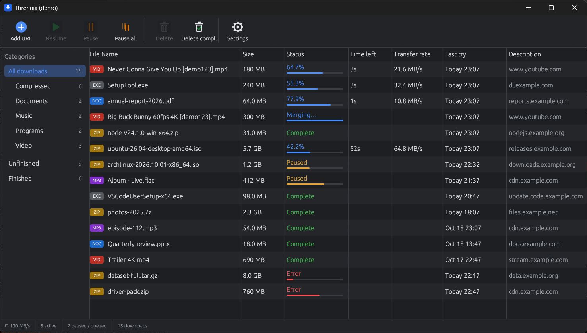
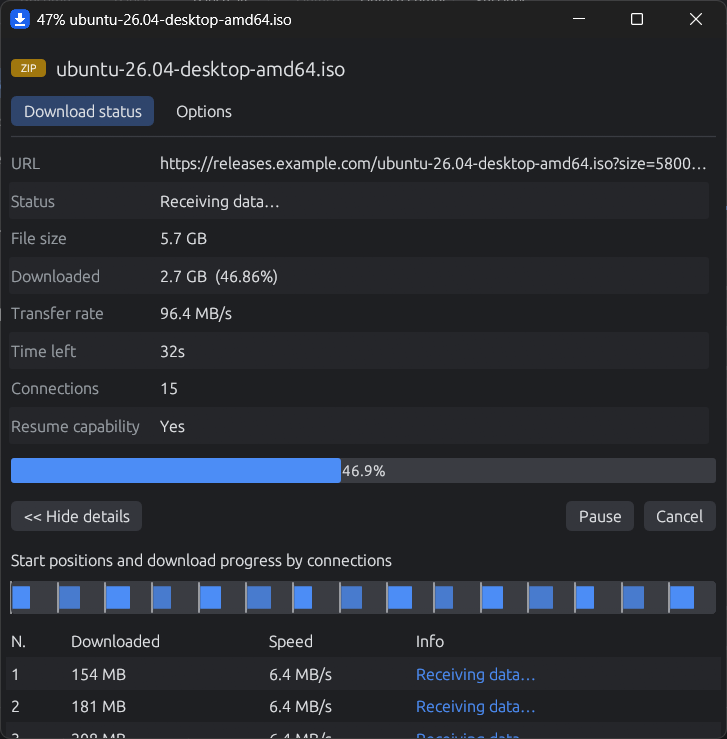
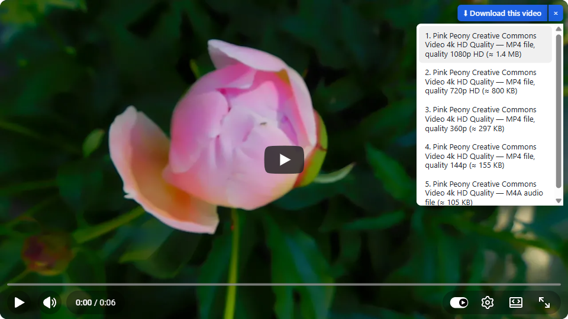
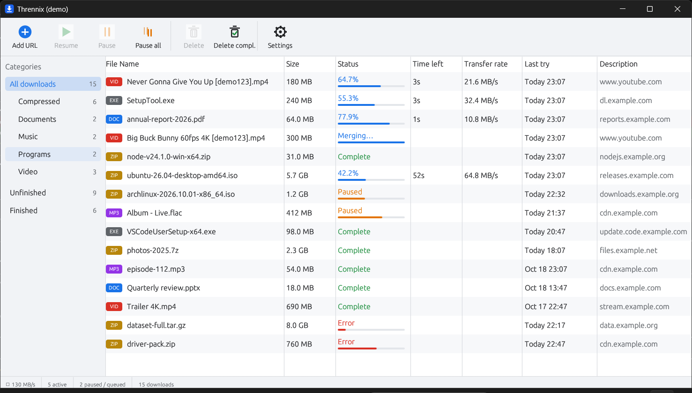
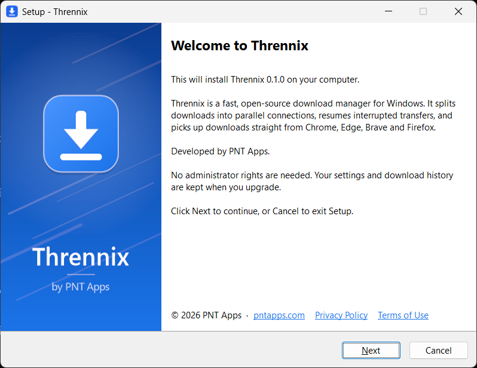

# Thrennix

A very fast, very simple download manager for Windows, written in Rust.

Developed by [PNT Apps](https://www.pntapps.com/)



## Install

1. Download **`Thrennix-Setup-<version>.exe`** from [GitHub Releases](https://github.com/pntapps/thrennix/releases/latest) and run it. No administrator rights are needed.
2. In the setup wizard, keep **ffmpeg** (video) and **yt-dlp** (YouTube) ticked if you want those features.
3. Load the browser extension: open `chrome://extensions` (or `edge://extensions`), turn on **Developer mode**, click **Load unpacked**, and select the `extension` folder (Start menu → *Thrennix browser extension folder*).

The installer isn't code-signed yet, so Windows SmartScreen may say "Windows protected your PC". Click **More info → Run anyway**.

Prefer not to run an installer? The release also has a `thrennix-<version>-windows-x64.zip` with a script install (`install.ps1`) inside.

## Features

- **Multi-connection downloads**: starts with 8 connections and adds more (up to 32) while speed keeps rising
- **Dynamic segmentation**: when a connection frees up, it splits the piece that will finish *last*, so no connection sits idle and the end of the download doesn't drag
- **Slow-connection replacement**, fast TLS 1.3 reconnects, and no "assembling" step (each piece is written straight into place in the final file)
- **Pause / resume**, even after closing the app or rebooting, and "New URL…" for expired links
- **Browser extension** (Chrome, Edge, Firefox): catches downloads and detects videos (direct files, HLS and DASH)
- **YouTube** (and other sites yt-dlp supports): a "Download this video" button with an IDM-style quality list, up to 4K (needs `yt-dlp`)
- **Network drives**: download straight to a shared folder on your router, NAS or another PC (SMB / Samba); shared folders on the network are found automatically
- **Touch screens**: finger-friendly taps, press-and-hold for the menu, a roomier layout and the on-screen keyboard on Windows tablets
- **Light and dark themes**, a per-download window showing progress by connection, and one small `.exe`

DRM-protected services aren't supported.

## Screenshots

| Download window | YouTube quality list |
|---|---|
|  |  |

| Light theme | Setup wizard |
|---|---|
|  |  |

## Project layout

| Path | What |
|---|---|
| `crates/thrennix-core` | Download engine |
| `crates/thrennix-media` | HLS / DASH downloading (muxed with ffmpeg) |
| `crates/thrennix-app` | Desktop app (`thrennix.exe`, egui) and native messaging host |
| `crates/thrennix-cli` | Command-line downloader (`thrennix-cli.exe`) |
| `crates/thrennix-testserver` | Local HTTP server for tests and benchmarks |
| `extension/` | Browser extension (Manifest V3) |
| `bench/` | Benchmarks against aria2 and IDM |
| `docs/PROTOCOL.md` | Browser ⇄ app protocol |

## Build from source

Requirements: Rust (stable, MSVC toolchain) and the Visual Studio C++ Build Tools. ffmpeg is optional (needed for HLS/DASH video).

```powershell
cargo build --release
.\target\release\thrennix.exe --register   # registers the browser integration
.\target\release\thrennix.exe
```

Then load the extension: see [`extension/README.md`](extension/README.md).

## Command line

```powershell
.\target\release\thrennix-cli.exe https://example.com/big.iso -o D:\Downloads
```

Press Ctrl+C to pause. Run the same command again to resume.

## Benchmarks

See [`bench/README.md`](bench/README.md).

## About

Thrennix is developed by **PNT Apps**.

- Website: [www.pntapps.com](https://www.pntapps.com/)
- About us: [pntapps.com/about](https://www.pntapps.com/about)
- Privacy Policy: [pntapps.com/privacy](https://www.pntapps.com/privacy)
- Terms of Service: [pntapps.com/terms](https://www.pntapps.com/terms)

## License

Dual-licensed under either of [MIT](LICENSE-MIT) or [Apache-2.0](LICENSE-APACHE), at your option.
